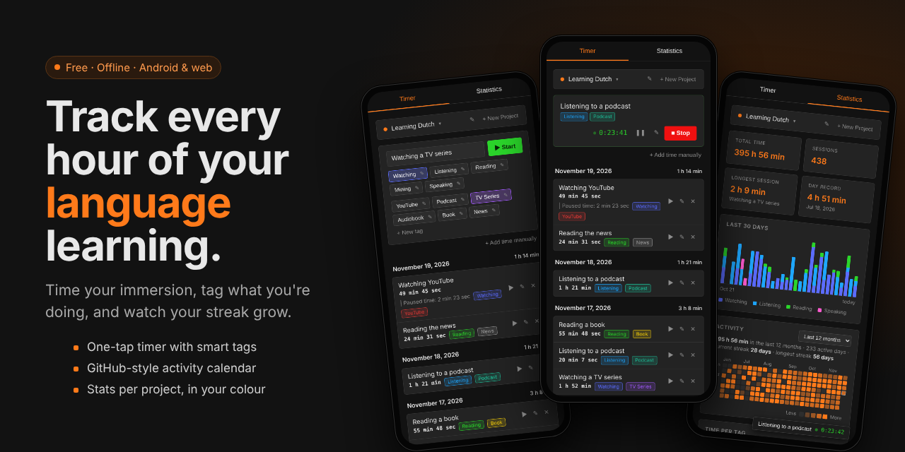
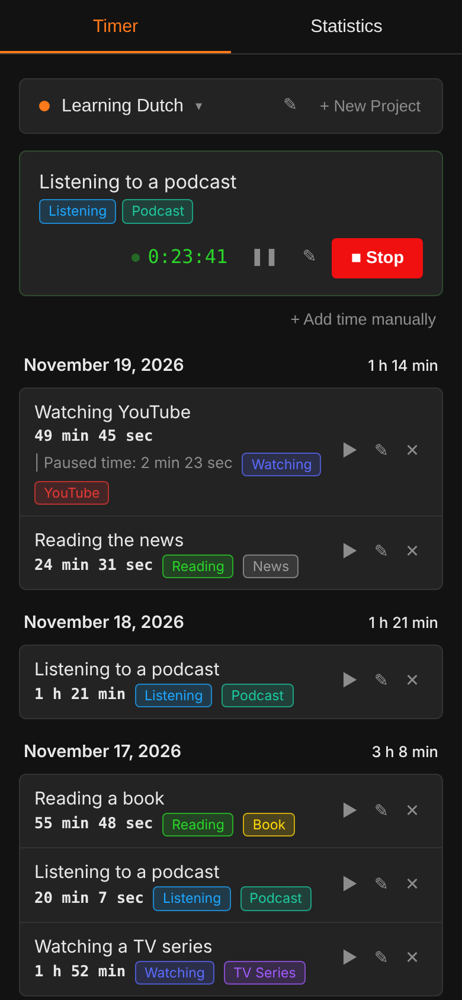
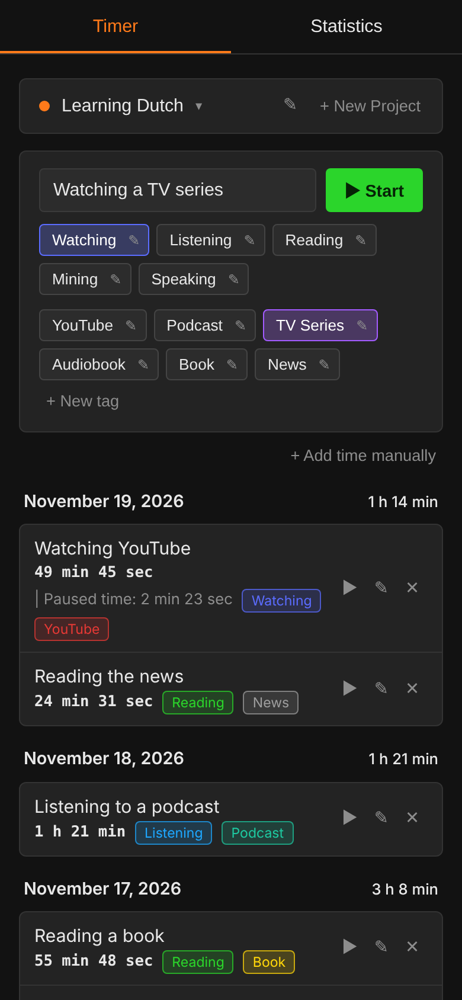
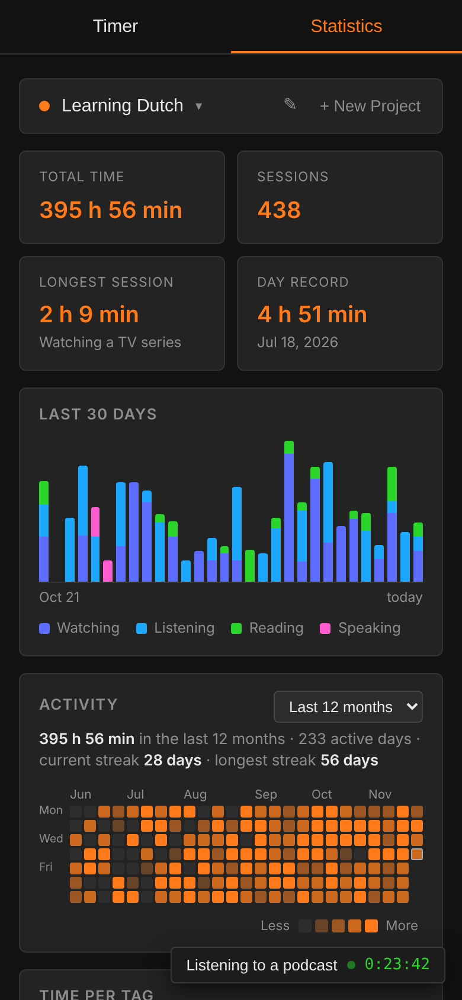
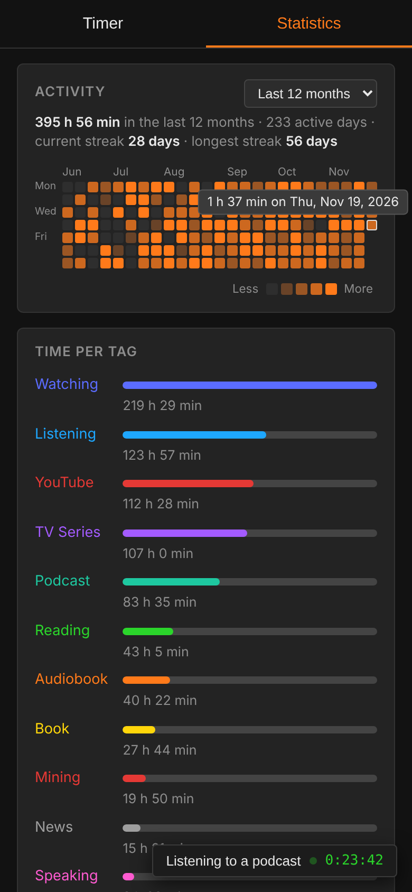

# Time Tracker



A small time tracker for language learning (or anything else): start a timer, tag what
you're doing, and see your history and statistics. It runs in any browser and as an
Android app, works offline, and keeps all data on your device.

**[Download the Android app (TimeTracker.apk)](TimeTracker.apk)**

## Screenshots

| Timer | Smart tags | Statistics | Activity |
|:---:|:---:|:---:|:---:|
|  |  |  |  |
| Start, pause and stop with one tap. History is grouped by day. | Pick *Watching* and *TV Series* and the name fills itself in. | Total time, sessions, records and the last 30 days. | A year of study at a glance, plus time per tag. |

## Features

- **Projects:** one per language or goal (e.g. "Learning Dutch"), each with its own colour.
  Statistics, charts and the heatmap are shown in that colour.
- **Tags** in two kinds:
  - **Activities** (Watching, Listening, Reading, Mining…) are listed first.
  - **Content** (YouTube, Podcast, Audiobook, Book…) follows.

  Picking tags builds the task name from them: *Watching YouTube*, *Reading a book*,
  *Listening to an audiobook*, *Reading the news*. Each content tag can take "a/an", "the"
  or no article, and each activity can have a word after it ("to", "about"…). Sensible
  defaults are chosen automatically. Text you type yourself is never overwritten.
- **Timer** with pause and resume, editing, and a floating mini timer. It keeps counting
  while the app is closed.
- **History** grouped by day, with continue, edit and delete, plus manual entries.
- **Statistics:**
  - Total time, sessions, longest session and day record.
  - A 30-day chart, colour-coded by activity, and time per tag.
  - A GitHub-style **activity heatmap** for the last 12 months or any year, with streaks.
- **CSV export** of a project.

## Use it in a browser

Open `index.html`. Data is stored in that browser's localStorage.

## Android app

Install `TimeTracker.apk` on an Android 7+ phone. Your browser or Files app will ask you to
allow installs from it.

To **update** the app, install a newer APK over the existing one and choose **Update**.
Don't uninstall first: uninstalling deletes the app's data.

### Building the APK

The `android/` folder is a minimal WebView wrapper built without Gradle:

```sh
ANDROID_HOME=/path/to/android-sdk android/build.sh   # needs platforms;android-34 and build-tools;35.0.0
```

This copies `index.html`, `index.js` and `styles.css` into the app and writes `TimeTracker.apk`.

The APK is signed with `android/timetracker.keystore`, which is **not** in this repository.
Keep your copy safe. Updates must be signed with the same key, or Android will refuse to
install them over the existing app. If the file is missing, `build.sh` creates a new key,
and APKs built with it can't update the old install.

When you release a new version, raise `versionCode` and `versionName` in `android/AndroidManifest.xml`.
